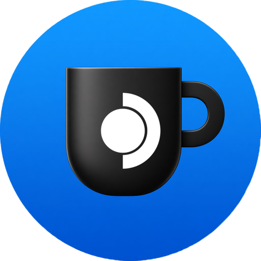
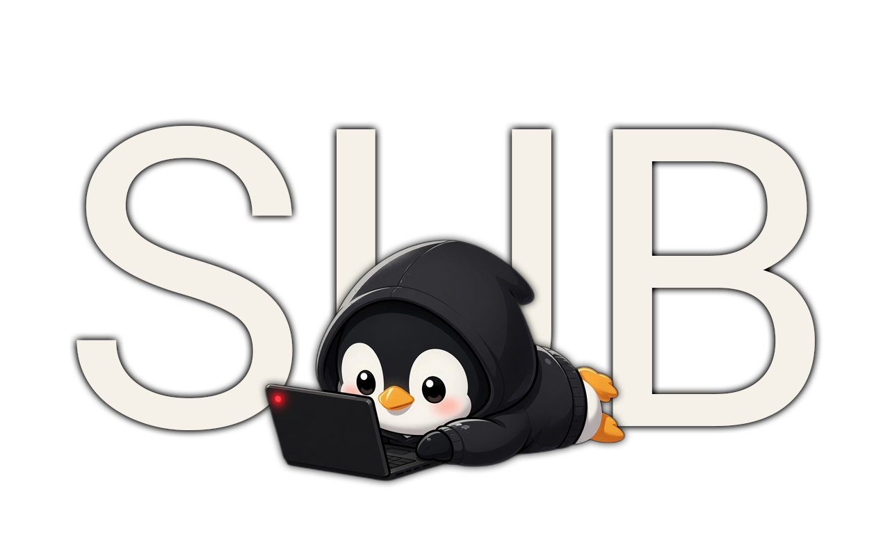

<p align="center">
  <a href="https://deckyloader.ru/">
    
  </a>
  <br>
  <strong>Bu eklenti <a href="https://deckyloader.ru/">Decky Loader Россия</a> desteğiyle geliştirilmiştir</strong>
</p>

# sub-deck

[🇺🇸 English](README.md) | [🇷🇺 Русский](README.ru.md) | [🇺🇦 Українська](README.uk.md) | [🇨🇳 简体中文](README.zh-CN.md) | [🇹🇼 繁體中文](README.zh-TW.md) | [🇸🇦 العربية](README.ar.md) | [🇮🇷 فارسی](README.fa.md) | [🇹🇷 Türkçe](README.tr.md)

Steam Deck için Decky Loader eklentisi. VLESS, VMess, Trojan, Shadowsocks ve Hysteria 2 aboneliklerinizi yönetmenizi ve `sing-box` kullanarak otomatik sistem genelinde TUN yönlendirmesiyle bunlara bağlanmanızı sağlar.



## 📋 Özellikler

- **Çoklu Protokol Desteği**: VLESS (Reality, TLS, None), VMess, Trojan, Shadowsocks ve Hysteria 2 / Hy2.
- **Birden Fazla Abonelik**: Farklı abonelik bağlantılarını aynı anda ekleyin ve yönetin. Tüm aboneliklerdeki düğümler otomatik olarak birleştirilir.
- **Sistem Genelinde TUN Yönlendirmesi**: Tüm Steam Deck internet trafiğini otomatik olarak `sing-box` TUN arayüzü (`subdeck0`) üzerinden yönlendirir.
- **Yönlendirme Modları**: **"Varsayılan"** mod (tüm trafik VPN üzerinden geçer) ve **[RoscomVPN](https://github.com/hydraponique/roscomvpn-routing)** modu (akıllı yönlendirme: Steam, Twitch ve yerel web siteleri doğrudan bağlanır, engelli siteler VPN üzerinden geçer, reklamlar ve telemetri engellenir) desteği.
- **Tek Tıkla Bağlantı**: Listeden sunucuya tıklayarak bağlanın, bağlantıyı kesmek için tekrar tıklayın.
- **Hızlı Loglama**: Eklenti ve çekirdek loglarını `/home/deck/sub-deck.log` dosyasına yazmak ve panoya kopyalamak için **LOG** düğmesine tıklayın.
- **Root Ayrıcalıkları**: Ağ yapılandırması için sorunsuz şekilde `root` olarak çalışır.
- **Bağımlılık Gerektirmez**: İlk bağlantıda `sing-box` çekirdek ikili dosyasını otomatik olarak indirir.

## 🎁 Dahili Ücretsiz Abonelikler

Eklenti, önceden doğrulanmış ve otomatik olarak güncellenen üç kaynağı tek bir tıklamayla ekleyen bir **"Ücretsiz Abonelikler"** düğmesi içerir:
- [igareck Aboneliği](https://github.com/igareck/vpn-configs-for-russia): Rusya'daki engellemeleri aşmak için klasik, doğrulanmış yapılandırma kaynağı.
- [Goida VPN (AvenCores)](https://gitlab.com/avencores/goida-vpn-configs): Goida VPN projesinden sık sık güncellenen VLESS yapılandırmaları.
- [zieng2/wl Aboneliği](https://github.com/zieng2/wl): zieng2 wl deposundan yüksek kaliteli evrensel VLESS yapılandırmaları.

*Not: Performans ve hız için, ücretsiz abonelikler paralel TCP ping testine tabi tutularak en hızlı 15 aktif sunucu gösterilecek şekilde otomatik olarak filtrelenir (kullanıcı tarafından eklenen aboneliklerde sınır yoktur).*

## 📥 Kurulum

### 1. Decky Loader Kurulumu
Eklentinin çalışması için **Decky Loader** gereklidir. Masaüstü Modunda (Desktop Mode) terminali (Konsole) açın ve çalıştırın:
```bash
curl -L https://github.com/SteamDeckHomebrew/decky-installer/releases/latest/download/install_release.sh | sh
```
*(Veya bölgesel hızlı aynalara sahip sürüm [Decky Loader Russia](https://deckyloader.ru/): `curl -sL https://deckyloader.ru/install.sh | sh`)*

### 2. sub-deck Eklentisi Kurulumu
1. [Sürümler (Releases)](https://github.com/rosakodu/sub-deck/releases) sayfasından en son sürümü (`sub-deck.zip`) indirin veya manuel olarak derleyin.
2. ZIP dosyasını Steam Deck'inize kopyalayın.
3. Steam Ayarlarında **Geliştirici Modunu (Developer Mode)** etkinleştirin.
4. Decky Loader ayarlarında (dişli simgesi) -> **Developer** bölümünden **Developer mode**'u açın ve **"Install plugin from file"** (`sub-deck.zip`) seçeneğini belirleyin.

## 🚀 Nasıl Kullanılır

1. Abonelik URL'nizi girin (ör. `https://...`) ve **"Add Subscription"** düğmesine tıklayın.
2. Bağlantıyı etkinleştirmek için **"Available Servers"** listesindeki herhangi bir sunucuya tıklayın.
3. Seçilen sunucu vurgulanacak ve üst etikette **"Connected to: <name>"** gösterilecektir.
4. Bağlantıyı kesmek için listedeki aktif sunucuya tekrar tıklamanız yeterlidir.

## ⚖️ Lisans

BSD-3-Clause Lisansı.
